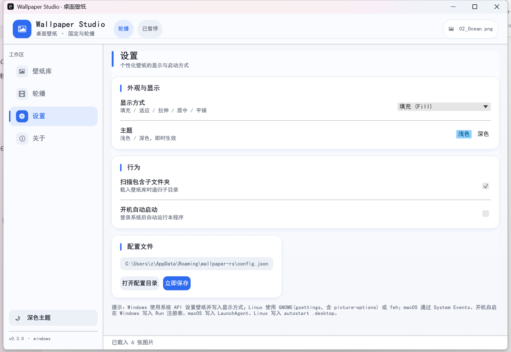
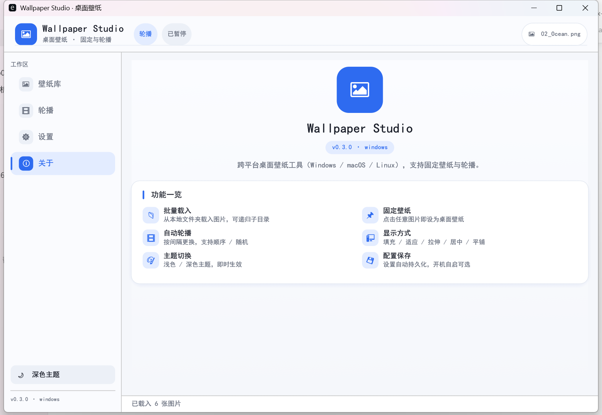
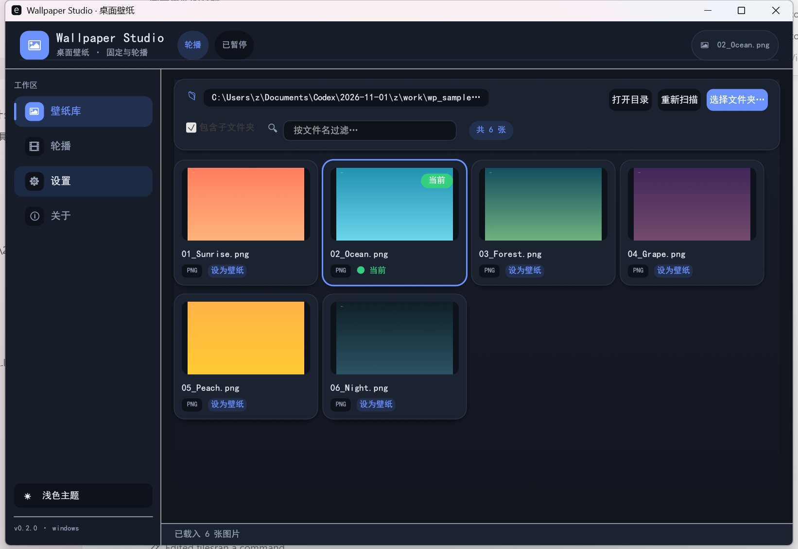

# wallpaper-rs

<p align="center">🌐 <b>Language</b>：<a href="README.md">简体中文</a> · <a href="README.en.md">English</a> · <a href="README.zh-TW.md">繁體中文</a> · <a href="README.ja.md">日本語</a> · <a href="README.ko.md">한국어</a> · <a href="README.ru.md">Русский</a> · <a href="README.es.md">Español</a> · <a href="README.fr.md">Français</a> · <a href="README.de.md">Deutsch</a> · <a href="README.pt-BR.md">Português</a></p>

A **cross-platform desktop wallpaper app** built with **Rust + egui/eframe**
(Windows / macOS / Linux). One UI covers both **fixed wallpaper** and
**slideshow (timed rotation)** modes. **Runs fully offline — no login, no
subscription, no telemetry.**

<p>
  
  
  
  
</p>


---

## Features

- **Library**: scan a local folder (optionally recursive) and browse thumbnails in a grid, with filename search.
- **Fixed wallpaper**: click a thumbnail or "Set as wallpaper" to apply instantly.
- **Slideshow**: auto-change on an interval, sequential or random, with a progress bar showing time to the next change.
- **Display mode**: Fill / Fit / Stretch / Center / Tile (Windows registry; Linux via GNOME `picture-options`).
- **Theme**: light / dark toggle with instant restyle.
- **Persistent config**: folder, mode, interval, fit, theme and last wallpaper are saved locally.
- **Launch at login**: one toggle — Windows `Run` key, macOS `LaunchAgent`, Linux autostart `.desktop`.
- **Keyboard shortcuts**: `←` previous, `→` next.
- **Single binary, pure Rust**: no WebView or runtime; embedded CJK font, no missing-glyph boxes.

## Screens

| Library | Slideshow |
|---|---|
|  |  |

| Settings | About |
|---|---|
|  |  |

Dark theme:



## Platforms

| Platform | Status | How the wallpaper is set |
|---|---|---|
| Windows x64 | ✅ Built & verified | `SystemParametersInfoW` + registry `Control Panel\Desktop` |
| macOS | ✅ Source supported | `osascript` via System Events |
| Linux | ✅ Source supported | GNOME `gsettings`, falling back to `feh` |

## Config location

| Platform | Path |
|---|---|
| Windows | `%APPDATA%\wallpaper-rs\config.json` |
| macOS | `~/Library/Application Support/wallpaper-rs/config.json` |
| Linux | `$XDG_CONFIG_HOME/wallpaper-rs/config.json` (default `~/.config/wallpaper-rs/config.json`) |

## Build

Requires Rust 1.75+ (stable recommended).

```bash
cargo build --release
```

Output: `target/release/wallpaper-rs` (`wallpaper-rs.exe` on Windows).

### Run

```bash
cargo run --release
```

### Self-test

```bash
cargo run -- --selftest      # config serialization + image decoder check
cargo run -- --version       # print version
```

## Quick start

1. Open the app, go to **Library**, click **Choose folder…** and pick an image directory.
2. Click any thumbnail to set a fixed wallpaper, or open **Slideshow**, choose an interval/order and press **Start**.
3. In **Settings**, change the display mode and theme; configuration is saved automatically.

## License

[MIT](LICENSE) © shuying-code
