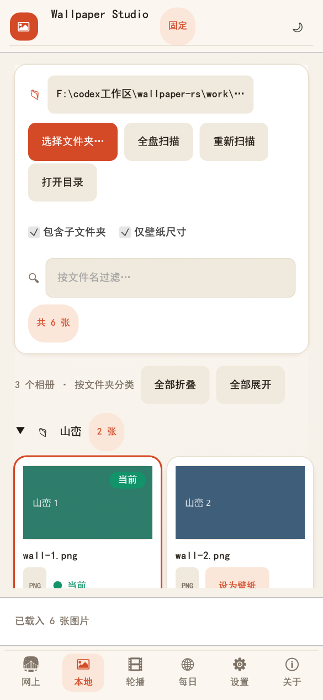
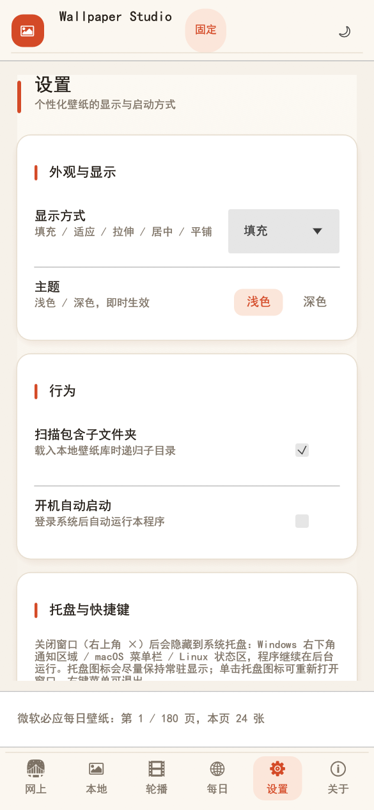

# wallpaper-rs

<p align="center">🌐 <b>Language</b>：<a href="README.md">简体中文</a> · <a href="README.en.md">English</a> · <a href="README.zh-TW.md">繁體中文</a> · <a href="README.ja.md">日本語</a> · <a href="README.ko.md">한국어</a> · <a href="README.ru.md">Русский</a> · <a href="README.es.md">Español</a> · <a href="README.fr.md">Français</a> · <a href="README.de.md">Deutsch</a> · <a href="README.pt-BR.md">Português</a></p>

A **cross-platform desktop wallpaper app** built with **Rust + egui/eframe**
(Windows / macOS / Linux). One UI covers **fixed wallpaper**, **timed slideshow**
and **live wallpaper** (video). It opens on the **Online library** by default;
**no login, no subscription, no telemetry.**

<p>
  
  
  
  
  
  
</p>

<p align="center">
  
</p>

<p align="center">
  
  
</p>

---

## Download

Get the latest build from the [latest Release](https://github.com/shuying-code/wallpaper-rs/releases/latest):

| Platform | Portable | Installer |
|---|---|---|
| Windows (x64) | [.zip](https://github.com/shuying-code/wallpaper-rs/releases/latest/download/wallpaper-rs-windows-x64.zip) · [single-file exe](https://github.com/shuying-code/wallpaper-rs/releases/latest/download/wallpaper-rs-windows-x64.exe) | [setup.exe](https://github.com/shuying-code/wallpaper-rs/releases/latest/download/wallpaper-rs-windows-x64-setup.exe) |
| macOS (Universal, Intel + Apple Silicon) | [.tar.gz](https://github.com/shuying-code/wallpaper-rs/releases/latest/download/wallpaper-rs-macos-universal.tar.gz) | [.dmg](https://github.com/shuying-code/wallpaper-rs/releases/latest/download/wallpaper-rs-macos-universal.dmg) |
| Linux / Ubuntu (x64) | [.tar.gz](https://github.com/shuying-code/wallpaper-rs/releases/latest/download/wallpaper-rs-linux-x64.tar.gz) | [.deb](https://github.com/shuying-code/wallpaper-rs/releases/latest/download/wallpaper-rs-linux-x64.deb) · [.AppImage](https://github.com/shuying-code/wallpaper-rs/releases/latest/download/wallpaper-rs-linux-x64.AppImage) |
| Android | — | [.apk](https://github.com/shuying-code/wallpaper-rs/releases/latest/download/wallpaper-rs-android-universal.apk) |
| All versions |  | [Releases page](https://github.com/shuying-code/wallpaper-rs/releases/latest) |

> Windows also ships a **single-file exe** (`wallpaper-rs-windows-x64.exe`, ~5 MB) that **no longer embeds mpv**, keeping the download small. On first use of live wallpaper / lock screen the app **checks for a local mpv**, and if missing it **speed-tests several mirrors and downloads the fastest** portable mpv to `%LOCALAPPDATA%\wallpaper-rs\mpv-runtime`. mpv is a third-party GPL component — see `THIRD-PARTY-NOTICES.md`.

You can also click the download links in the in-app **About** page.

## Features

- **Online wallpaper library (multi-site, default home)**: browse four real wallpaper sites and switch the source in one click — **① Bing Daily Wallpaper 4K** (`bing.ioliu.cn`, updated daily, download the 3840×2160 original), **② Netbian** (`pic.netbian.com`, 4K / 5K / 8K), **③ MoeWalls** (`moewalls.com`), **④ MotionBGs** (`motionbgs.com`). Every site supports **keyword search**, **category / tag browsing** and **pagination**; thumbnails lazy-load, and opening the preview lets you **download the original / set as desktop / set as lock screen**, with the chosen action running automatically once the original finishes downloading. Live sites (MoeWalls / MotionBGs) additionally offer **"Download live wallpaper MP4"** (saved to `Pictures/网上壁纸库/<site>`). The list supports **favorites / favorites-only** and "Clear thumbnail cache"; the preview also has "Open image page", "Set lock screen", **"Add to slideshow (original)"** and previous / next.
- **Live wallpaper (Windows / macOS / Linux-X11, self-hosted desktop layer)**: on a live site (MoeWalls / MotionBGs) click **"Set as live wallpaper"** — the app creates a host window **behind the desktop icons** (Windows `WorkerW` / `Progman`; macOS `NSWindow` at the desktop level; Linux X11 `_NET_WM_WINDOW_TYPE_DESKTOP`) and plays the MP4 on loop with **mpv** (`--wid`), while icons and the taskbar keep working; **"Stop live wallpaper"** or quitting restores everything. **mpv is not bundled** — Windows checks for a local mpv and downloads it on demand to `%LOCALAPPDATA%\wallpaper-rs\mpv-runtime`; macOS / Linux need a system mpv (`brew install mpv` / `apt install mpv`). mpv is a third-party GPL component — see `THIRD-PARTY-NOTICES.md`.
- **Library (folder albums)**: scan a local folder (optionally recursive) and group **images and videos** into albums by their containing folder; each album can be **expanded / collapsed**, with "Expand all / Collapse all" in the toolbar and filename search. Video cards offer **"Set as live wallpaper" / "Set lock screen"** and can join the slideshow.
- **Collapsible sidebar**: the `☰` button in the title bar hides / shows the left navigation to focus on the images; the state is remembered.
- **Permission request & authorization guidance**: when a scan hits folders it cannot read, instead of silently skipping them the app shows a banner with "Request permission / Retry" (on macOS this triggers the system privacy prompt) and "Open folder location / Open authorization settings" to jump to the OS authorization page or the file manager, letting the operator grant access.
- **Fixed wallpaper**: click a thumbnail or "Set as wallpaper" to apply instantly.
- **Slideshow**: auto-change on an interval, sequential or random, with a progress bar showing time to the next change. **If the mode is Slideshow the app starts rotating on launch**, and it **swaps one image immediately on open** before the first interval.
- **Live wallpapers join the slideshow**: the playlist can mix in **videos (live wallpapers)**; when a video comes up the app hands the desktop to mpv and restores on the next item.
- **No flash when switching into a live wallpaper**: before the video starts, mpv grabs the **first-frame poster** and lays it on the desktop (cached under `<config dir>/live_posters/`), so the frame is identical before/after mpv renders — a seamless switch.
- **Display mode**: Fill / Fit / Stretch / Center / Tile (Windows registry; Linux via GNOME `picture-options`).
- **Theme**: light / dark toggle with instant restyle.
- **Persistent config**: folder, mode, interval, fit, theme and last wallpaper are saved locally.
- **Launch at login**: one toggle — Windows `Run` key, macOS `LaunchAgent`, Linux autostart `.desktop`.
- **Full-disk scan**: background scan of all drives for images (skips system/cache dirs, bounded).
- **Close to system tray (icon kept visible)**: the top-right "X" hides the window to the system tray (Windows notification area / macOS menu bar / Linux status area) instead of quitting; the taskbar button disappears and rotation keeps running. On Windows the app tries to pin its tray icon as always-visible (`IsPromoted` in `NotifyIconSettings`) so Win11 doesn't tuck it into the hidden-icons overflow; Settings also has an "Open tray settings" button to pin it manually. Single-click the tray icon to restore the window centered; the tray menu's Quit is a real exit — it ends this process and also closes every other running wallpaper-rs instance on the machine.
- **Global hotkey**: `Ctrl+Alt+W` toggles show/hide of the window (auto-fallback to `Ctrl+Alt+Shift+W` / `Ctrl+Alt+F9` if taken).
- **Display aware**: detects monitor count and primary resolution; HiDPI handled by the OS; applies to all monitors.
- **Redesigned, responsive UI**: a warm editorial look (paper-cream + terracotta + deep teal); on narrow windows (phone / tablet, width < 820pt) it collapses the sidebar into a bottom tab bar, wraps controls, uses fluid 2–3 column cards and larger touch targets. Adapts across desktop, iOS and Android.
- **Paged lazy loading for large libraries**: an album with many images renders one page (48) at a time with a "Load more" button, on top of on-demand thumbnail decoding — thousands of images stay smooth and stay off your VRAM.
- **Multi-size adaptation screenshots (`--shots`)**: one command renders the UI at **phone / tablet / laptop / desktop** sizes for **each page (Library / Online / Slideshow / Settings / About)** and saves PNGs, for quick responsive review.
- **Online daily wallpaper**: fetch the Bing daily image (`cn.bing.com`, reachable in China) with "Learn about this picture", like / dislike, previous / next, set as desktop / lock screen, and daily auto-rotate.
- **Lock screen**: also set the current wallpaper as the system lock screen (Windows writes `PersonalizationCSP`, raising the UAC elevation prompt automatically — click Yes to finish, no need to run as administrator manually; Ubuntu/GNOME `gsettings` lock-screen `picture-uri`; macOS lock screen follows the system wallpaper).
- **Cross-platform global hotkey**: Windows `RegisterHotKey`; macOS / Linux(X11) via `global-hotkey`; toggle show/hide.
- **Keyboard shortcuts**: `←` previous, `→` next.
- **Single binary, pure Rust**: no WebView or runtime; embedded CJK font, no missing-glyph boxes.

## Screens

Warm redesigned look. Desktop uses the left sidebar (**Online library / Library / Slideshow / Daily / Settings / About**) and opens on the **Online library** by default (toggle with `☰`); narrow/mobile widths switch to a bottom tab bar (Online / Library / Slideshow / Daily / Settings / About).

| Library | Slideshow |
|---|---|
|  |  |

| Settings | About |
|---|---|
|  |  |

Dark theme:


Mobile compact layout (bottom tab bar):

| Library | Settings |
|---|---|
|  |  |

## Platforms

| Platform | Status | How the wallpaper is set |
|---|---|---|
| Windows x64 | ✅ Built & verified | `SystemParametersInfoW` + registry `Control Panel\Desktop`; **live wallpaper**: self-hosted window behind the desktop icons + `mpv` looping the MP4 |
| macOS | ✅ Source supported | `osascript` via System Events |
| Linux | ✅ Source supported | GNOME `gsettings`, falling back to `feh` |
| Android | 🧩 UI adapted (mobile toolchain required) | mobile host applies via `WallpaperManager` (needs `SET_WALLPAPER`); touch/narrow layout supported |
| iOS / iPadOS | 🧩 UI adapted (browse only) | iOS forbids programmatic wallpaper changes; export to Photos and set manually; touch/narrow layout supported |

## Config location

| Platform | Path |
|---|---|
| Windows | `%APPDATA%\wallpaper-rs\config.json` |
| macOS | `~/Library/Application Support/wallpaper-rs/config.json` |
| Linux | `$XDG_CONFIG_HOME/wallpaper-rs/config.json` (default `~/.config/wallpaper-rs/config.json`) |

## Build

Requires Rust 1.75+ (stable recommended).

```bash
cargo build --release
```

Output: `target/release/wallpaper-rs` (`wallpaper-rs.exe` on Windows).

### Run

```bash
cargo run --release
```

### Self-test

```bash
cargo run -- --selftest      # config serialization + image decoder check
cargo run -- --version       # print version
```

### Multi-size adaptation screenshots

```bash
cargo run --release -- --shots ./shots
# Renders phone(390×844) / tablet(834×1112) / laptop(1366×768, 1536×864) / desktop(1440×900)
# for each page (Library / Online / Slideshow / Settings / About) and saves <size>-<page>.png.
```

## Quick start

1. The app opens on the **Online library**: switch between four sites, search, page through, then set desktop / lock screen / download the original; live sites can also download the MP4 or **set a live wallpaper**.
2. For local images, open **Library** and click **Choose folder…**; click any thumbnail to set a fixed wallpaper (a video becomes a live wallpaper).
3. Open **Slideshow** to pick an interval/order and press **Start** (Slideshow mode starts automatically on launch); change the display mode and theme in **Settings** — configuration is saved automatically.

## License

[MIT](LICENSE) © shuying-code
