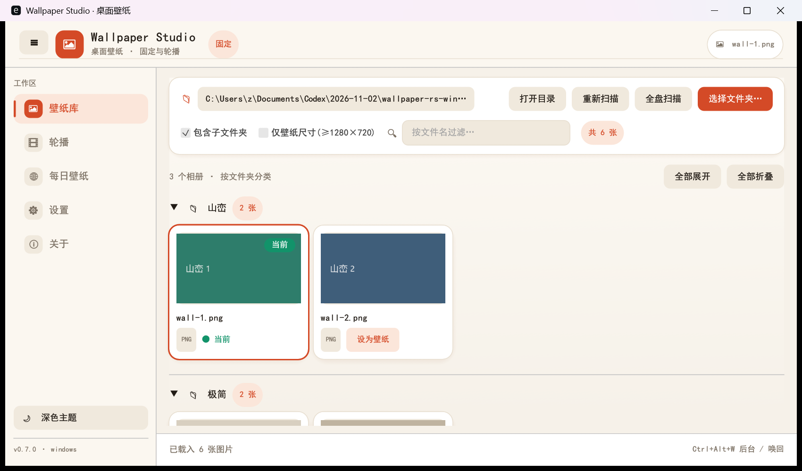
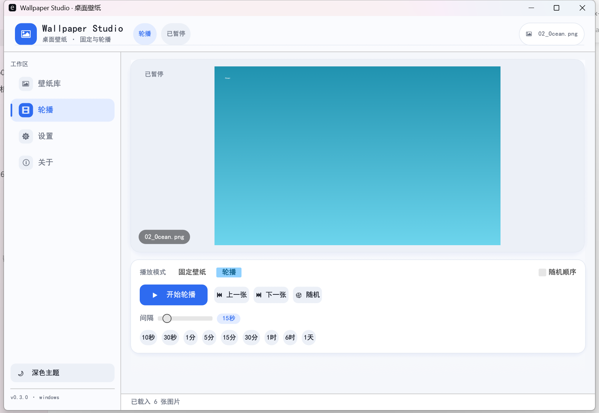

# wallpaper-rs

<p align="center">🌐 <b>Language</b>：<a href="README.md">简体中文</a> · <a href="README.en.md">English</a> · <a href="README.zh-TW.md">繁體中文</a> · <a href="README.ja.md">日本語</a> · <a href="README.ko.md">한국어</a> · <a href="README.ru.md">Русский</a> · <a href="README.es.md">Español</a> · <a href="README.fr.md">Français</a> · <a href="README.de.md">Deutsch</a> · <a href="README.pt-BR.md">Português</a></p>

**Rust + egui/eframe** で作られた**クロスプラットフォームのデスクトップ壁紙アプリ**（Windows / macOS / Linux）。
1 つの UI で **固定壁紙** と **スライドショー（時間で自動切り替え）** の両モードを利用できます。
**完全ローカル動作。ログイン・サブスク・テレメトリなし。**

<p>
  
  
  
  
</p>



---

## 機能

- **ライブラリ**：ローカルフォルダを走査（サブフォルダ対応）し、サムネイルをグリッド表示、ファイル名で検索。
- **固定壁紙**：サムネイルまたは「壁紙に設定」をクリックで即適用。
- **スライドショー**：指定間隔で自動切り替え、順序 / ランダム対応、次回までの残り時間をプログレスバーで表示。
- **表示モード**：フィル / フィット / ストレッチ / 中央 / タイル（Windows はレジストリで設定）。
- **テーマ**：ライト / ダークを即時切替。
- **設定の保存**：フォルダ、モード、間隔、表示モード、テーマ、最後の壁紙を自動保存。
- **ショートカット**：`←` 前へ、`→` 次へ。
- **単一バイナリ・純 Rust**：WebView やランタイム不要。CJK フォント同梱。
- **ログイン時に自動起動**：ワンクリック切替。Windows は Run レジストリ、macOS は LaunchAgent、Linux は autostart。

## 画面

| ライブラリ | スライドショー |
|---|---|
|  |  |

## 対応プラットフォーム

| プラットフォーム | 状態 | 壁紙設定の実装 |
|---|---|---|
| Windows x64 | ✅ ビルド検証済み | `SystemParametersInfoW` + レジストリ |
| macOS | ✅ ソース対応 | `osascript`（System Events） |
| Linux | ✅ ソース対応 | GNOME `gsettings`、なければ `feh` |

## 設定ファイル

| プラットフォーム | パス |
|---|---|
| Windows | `%APPDATA%\wallpaper-rs\config.json` |
| macOS | `~/Library/Application Support/wallpaper-rs/config.json` |
| Linux | `$XDG_CONFIG_HOME/wallpaper-rs/config.json`（既定 `~/.config/wallpaper-rs/config.json`） |

## ビルド

Rust 1.75+（stable 推奨）。

```bash
cargo build --release
```

## ライセンス

[MIT](LICENSE) © shuying-code
