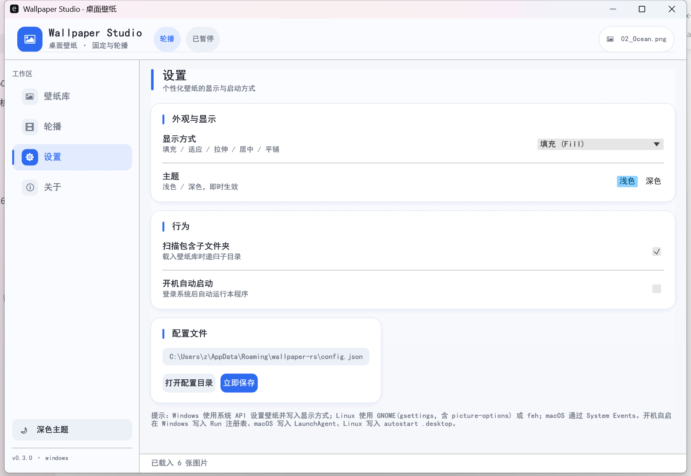
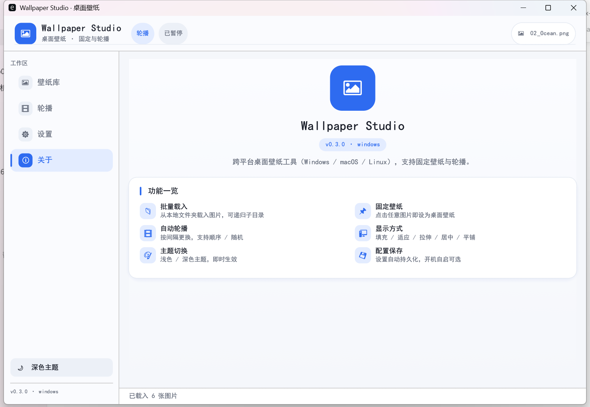
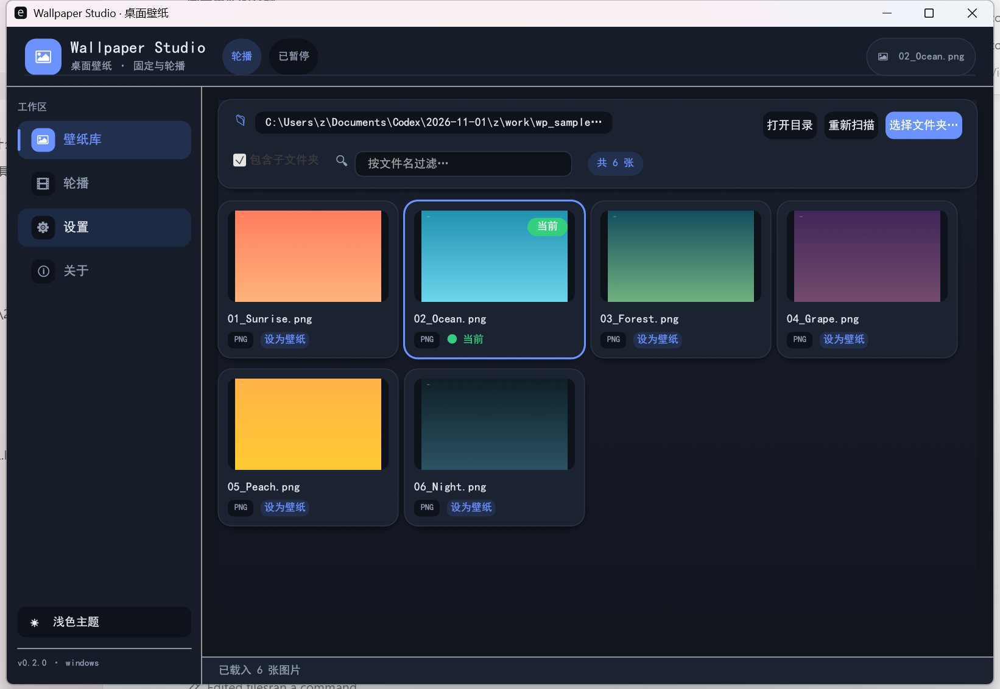

# wallpaper-rs

<p align="center">🌐 <b>Language</b>：<a href="README.md">简体中文</a> · <a href="README.en.md">English</a> · <a href="README.zh-TW.md">繁體中文</a> · <a href="README.ja.md">日本語</a> · <a href="README.ko.md">한국어</a> · <a href="README.ru.md">Русский</a> · <a href="README.es.md">Español</a> · <a href="README.fr.md">Français</a> · <a href="README.de.md">Deutsch</a> · <a href="README.pt-BR.md">Português</a></p>

用 **Rust + egui/eframe** 编写的**跨平台桌面壁纸软件**（Windows / macOS / Linux），
一套界面即可完成 **固定壁纸** 与 **轮播（定时自动更换）** 两种模式。
**完全本地运行，无登录、无订阅、无遥测。**

<p>
  
  
  
  
</p>


---

## 功能

- **壁纸库**：从本地文件夹批量扫描图片（可含子文件夹），网格缩略图浏览，按文件名搜索过滤。
- **固定壁纸**：点击缩略图或「设为壁纸」，立即应用到桌面。
- **轮播模式**：按设定间隔自动更换，支持顺序 / 随机播放，进度条显示距下次更换的剩余时间。
- **显示方式**：填充 / 适应 / 拉伸 / 居中 / 平铺（Windows 写注册表，Linux 通过 GNOME `picture-options`）。
- **主题**：浅色 / 深色一键切换，样式即时生效。
- **配置持久化**：文件夹、模式、间隔、显示方式、主题、上次壁纸等自动保存到本地配置文件。
- **开机自启**：一键开关，Windows 写 `Run` 注册表、macOS 写 `LaunchAgent`、Linux 写 autostart `.desktop`。
- **键盘快捷键**：`←` 上一张，`→` 下一张。
- **单文件、纯 Rust**：无需 WebView 或运行时，双击即用；内嵌中文字体，无缺字方框。

## 图形界面（GUI）

左侧为分段式导航（壁纸库 / 轮播 / 设置 / 关于），右侧为内容区，底部状态栏显示载入数量与操作结果。

| 壁纸库 | 轮播 |
|---|---|
|  |  |

| 设置 | 关于 |
|---|---|
|  |  |

深色主题：



## 支持的平台

| 平台 | 状态 | 设置壁纸的实现 |
|---|---|---|
| Windows x64 | ✅ 已构建验证 | `SystemParametersInfoW` + 注册表 `Control Panel\Desktop` |
| macOS | ✅ 源码支持 | `osascript` 调用 System Events 设置桌面图片 |
| Linux | ✅ 源码支持 | GNOME `gsettings`，或回退到 `feh` |

三大平台共用同一套源码；配置文件写入各平台的标准目录（见下）。

## 配置文件位置

| 平台 | 路径 |
|---|---|
| Windows | `%APPDATA%\wallpaper-rs\config.json` |
| macOS | `~/Library/Application Support/wallpaper-rs/config.json` |
| Linux | `$XDG_CONFIG_HOME/wallpaper-rs/config.json`（默认 `~/.config/wallpaper-rs/config.json`） |

## 构建

需要 Rust 1.75+（推荐 stable）。

```bash
cargo build --release
```

产物：`target/release/wallpaper-rs`（Windows 为 `wallpaper-rs.exe`）。

### 运行

```bash
cargo run --release
```

### 自检

```bash
cargo run -- --selftest      # 配置序列化 + 图片解码器检查
cargo run -- --version       # 打印版本
```

## 使用速览

1. 打开程序，进入「壁纸库」，点击「选择文件夹…」选中图片目录。
2. 点击任意缩略图即可设为固定壁纸；或进入「轮播」选择间隔与顺序后点「开始」。
3. 在「设置」里切换显示方式与主题；配置会自动保存。

> 详细图文步骤见 [docs/用户操作手册.md](docs/用户操作手册.md)。

## 目录结构

```
wallpaper-rs/
├─ src/
│  ├─ main.rs        # 入口、--selftest、窗口参数
│  ├─ app.rs         # GUI：壁纸库 / 轮播 / 设置 / 关于
│  ├─ theme.rs       # 配色、样式、系统 CJK 字体加载
│  ├─ config.rs      # 配置结构、跨平台配置目录
│  ├─ wallpaper.rs   # 各平台设置壁纸实现
│  ├─ autostart.rs   # 开机自启（Windows 注册表 / LaunchAgent / autostart）
│  └─ thumbs.rs      # 缩略图工作线程
├─ docs/             # 用户操作手册与文档索引
├─ assets/           # 截图
└─ dist/             # 本机构建产物（Windows exe）
```

## 许可

[MIT](LICENSE) © shuying-code
